# apple-fm

**Apple Intelligence from your command line and your code.** apple-fm gives you
Apple's **Foundation Models** on **macOS 26+ / Apple Silicon**. Inference runs
on-device and works offline without an API key.

apple-fm provides a lightweight CLI and TypeScript library for the Foundation
Models framework, including persistent, permission-gated chat.

<p align="center">
  
</p>

## Why apple-fm

- **From shell or TypeScript.** Check model availability, generate or stream a
  response, extract content tags, and count prompt tokens.
- **Structured JSON.** Native guided generation enforces supported JSON Schema
  constraints and can stream complete JSON snapshots.
- **Compare local images.** Attach multiple images to one prompt on macOS 27+,
  including prompts that return guided JSON.
- **Pick up a chat later.** Save and resume a persistent session. Chat summarizes
  older turns as context fills, `/usage` shows how much context is occupied, and
  **Esc** interrupts a streamed reply while keeping the partial response.
- **Permission-gated tools.** Enable local file reads and shell commands in chat,
  or register your own tools through the TypeScript library.
- **Zero Node runtime dependencies.** The Swift helper resolves Apple's current
  on-device model at runtime.

## Model selection

```sh
apple-fm probe
apple-fm generate --model on-device "Explain Swift actors in one sentence"
apple-fm chat --model on-device
```

`probe` reports the current on-device model and its availability on macOS 26 and
later. The model ID is `on-device`, which is also the default for generation and chat.
On macOS 26.4 and later, `apple-fm tokens 'text'` prints the native prompt token
count. It also reads text from stdin. `probe` reports the model's `contextSize`
where available. In chat, `/usage` shows the current context count and capacity when
native counting is available, or a labeled estimate on older helpers.

On macOS 27 and later, repeat `--image` to compare local images in the order you
attach them. Add `--schema` to return guided JSON.

```sh
apple-fm generate --image before.png --image after.png "What changed between these images?"
```

In chat, use `/save session.json` and later `apple-fm chat --resume session.json`
to continue the conversation. If you enabled tools, pass the same `--tools` list
when resuming.

Use `generate --sampling greedy` to select the highest-probability token at each step.

Use `apple-fm generate --use-case content-tagging "A picnic at the beach"` to
extract tags as a JSON array.
See [model discovery and selection](docs/12-models.md) for the full contract.

## Install

```bash
npm install -g apple-fm     # CLI
npm install apple-fm        # library
```

Requires Node.js 20+ for the package and macOS 26+ on Apple Silicon with Apple
Intelligence enabled for inference. The published package normally bundles a
Developer ID-signed, notarized helper. A source checkout or a package published
without the helper needs a local Swift build. In the checkout, run `npm ci`,
`npm run build:helper`, then `npm run build` and use `node dist/cli.js probe`.
Use Xcode 27 for an image-capable build. See [release details](docs/5-releasing.md).

### Platform support

apple-fm **installs on any OS** — so it can be a dependency of a cross-platform
project — but the on-device model only *runs* on **macOS 26+ Apple Silicon**.
Everywhere else it degrades gracefully instead of crashing: `probe()` returns
`{ available: false, reason: 'unsupportedPlatform' }`, and `generate` / `chat`
throw a clear `[unsupportedPlatform]` error. Gate on `isPlatformSupported()` or
`probe()`:

```ts
import { probe, generate } from 'apple-fm';

if ((await probe()).available) {
  await generate({ prompt: '…' });
} else {
  // fall back (cloud model, cached result, skip the feature, …)
}
```

## CLI

```bash
apple-fm probe                       # list models and availability
apple-fm tokens "Count this text"     # native prompt token count on macOS 26.4+
apple-fm generate "Summarize: …"     # one-shot text
cat notes.md | apple-fm generate     # read the prompt from stdin
apple-fm generate "…" --stream       # stream tokens as they arrive
apple-fm generate "…" --schema shape.json   # structured/guided JSON output
apple-fm chat                        # interactive chat (streamed, auto-compacted)
apple-fm chat --tools read,bash      # let the model read files / run commands (gated)
```

Run `apple-fm --help` for the full flag list.

### Check availability

Before generating, confirm Apple Intelligence is ready on this machine.

<p align="center">
  
</p>

### Structured output

Pass a supported JSON Schema with `--schema` to get JSON that conforms to it.
Apple's native guided generation enforces the supported constraints. See the
[supported JSON Schema subset](docs/6-guided-generation.md).

<p align="center">
  
</p>

### Interactive chat

`chat` is a multi-turn REPL that streams replies and compacts the transcript
automatically near the context window. Use `/usage` to see context occupancy,
`/save` to save a chat, `/tools` to list enabled tools, and `/help` for all
commands. Press **Esc** while the model is replying to keep the partial reply.

<p align="center">
  
</p>

### Tool calling

Opt `chat` into built-in tools and the on-device model can call them mid-reply to
answer you — `read` (read a local file) and `bash` (run a shell command):

```bash
apple-fm chat --tools read,bash
```

Chat prompts for permission by default. Use `--allow-tool "bash:git status"` to
approve that exact command in advance. With `--yes`, file reads are approved
automatically and shell commands still require approval. In non-interactive chat,
calls that require a prompt are denied. Approved shell commands run with your user
permissions and can access the network. Library consumers can register their own
`Tool`. See [tool calling](docs/9-tool-calling.md).

## Library

```ts
import { probe, generate, ChatSession } from 'apple-fm';

if ((await probe()).available) {
  // One-shot
  const summary = await generate({ prompt: 'Summarize: …', system: 'Be terse.' });

  // Streaming
  await generate({ prompt: '…', stream: true }, {}, (chunk) => process.stdout.write(chunk));

  // Guided output using a supported JSON Schema
  const json = await generate({
    prompt: 'Recommend a classic sci-fi novel',
    schema: {
      type: 'object',
      properties: { title: { type: 'string' } },
      required: ['title'],
    },
  });

  // Multi-turn chat: one persistent on-device session, auto-compacted
  const chat = new ChatSession({ system: 'You are a helpful assistant.' });
  try {
    const reply = await chat.send('Hello');
  } finally {
    chat.close();
  }
}
```

The full API (`probe`, `generate`, `ChatSession`, protocol helpers, and types) is
documented in [docs/ai/code-summary.md](docs/ai/code-summary.md).

## How it works

The Node CLI and library talk to a Swift helper over newline-delimited JSON.
The helper runs inference through Apple’s Foundation Models framework and keeps
the native chat session alive across turns.

## Documentation

- [Overview](docs/1-overview.md) — what apple-fm is and its principles
- [Architecture](docs/2-architecture.md) — module layout and data flow
- [Wire protocol](docs/4-protocol.md) — the NDJSON helper ⇄ Node protocol
- [Requirements](docs/3-requirements.md) — every feature and its status
- [Tool calling](docs/9-tool-calling.md) — the extensible, permission-gated tool system

## Disclaimer

apple-fm is an independent, unofficial project and is **not affiliated with,
endorsed by, or sponsored by Apple Inc.** It simply provides command-line and
programmatic access to Apple's on-device Foundation Models on machines that
already support them (macOS 26+ on Apple Silicon with Apple Intelligence enabled).
Apple, Apple Intelligence, Apple Silicon, Foundation Models, and macOS are
trademarks of Apple Inc.

## License

MIT © Brian Westphal
