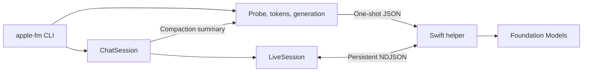

# 2. Architecture

Two layers: a **native helper** that owns all contact with `FoundationModels`,
and a **Node layer** that drives it over line-delimited JSON (NDJSON).

## Modules (`src/`)

| File | Responsibility |
| --- | --- |
| `types.ts` | Shared types: `Message`, `GenerateRequest`, `ProbeResult`, `HelperEvent`, `HelperOptions`. |
| `protocol.ts` | Pure NDJSON helpers: `encodeRequest`, `splitLines`, `parseEvent`, `flattenMessages`, `estimateTokens`, `estimateConversationTokens`. |
| `helper.ts` | Helper discovery, model probe, native token counting and one-shot generation. |
| `liveSession.ts` | `LiveSession` — one long-lived `--session` helper process (KV-cache reuse) implementing the `ChatBackend` contract; id-correlated turn/reset/close. |
| `session.ts` | `ChatSession` — multi-turn history + automatic context compaction over a `LiveSession` backend. |
| `chatFile.ts` | Atomic snapshot writes and validation of resume files. |
| `cliArgs.ts` | `parseArgs()` + `USAGE` (pure, testable). |
| `repl.ts` | Interactive chat loop (readline around `ChatSession`). |
| `cli.ts` | The `apple-fm` bin (thin: parse → I/O → delegate). |
| `index.ts` | Public API surface. |

## Native helper (`apple-fm-helper/*.swift`)

`scripts/build-apple-fm-helper.sh` compiles the Swift sources into one executable.
`main.swift` dispatches the one-shot probe, token count, generation, image and
content tagging requests, and runs the persistent session. `GuidedGeneration.swift`
translates JSON Schema, `Tools.swift` adapts the model's tools, and `ToolBridge.swift`
tracks replies. The [protocol reference](4-protocol.md) lists every mode and
its availability. The Node suite runs without a model asset using the stub helper.

## Data flow

1. `cli.ts` parses argv into a `ParsedArgs`.
2. **probe** → `helper.probe()` spawns `--probe`, reads the single availability
   line.
3. **tokens** → `helper.countTokens()` sends a prompt to `--tokens` for native
   accounting on macOS 26.4+.
4. **generate** → `helper.generate()` selects the Swift mode for the requested
   input and use case. Guided streams produce JSON snapshot events. Text streams
   produce deltas.
5. **chat** → `repl.ts` drives a `ChatSession`. Each turn runs against a
   persistent `LiveSession` (`liveSession.ts`) — one `--session` helper process
   holding a single `LanguageModelSession` across turns (KV-cache reuse) rather
   than replaying the transcript each turn. When the estimated size crosses
   `compactAtTokens`, the session summarizes older turns via a one-shot `generate`
   call and reseeds the live session with the recap plus the most recent turns.

## Trust boundaries

- **Helper subprocess** — bounded by a timeout; stderr captured and surfaced on
  failure; stdin EPIPE swallowed if the helper exits early.
- **Helper output** — one-shot calls validate response events. The live session
  correlates events to its pending command IDs and ignores unrelated events.
- **On-device model** — runs locally; no network egress. Availability and failure
  reasons (`appleIntelligenceNotEnabled`, `contextWindowExceeded`, …) are
  reported as structured codes.

## Distribution

The npm package includes `bin/apple-fm-helper` when the signing workflow produces
it, and includes Swift source and the build script for local builds. Discovery
checks explicit `binPath`, then `APPLE_FM_BIN`, then the bundled absolute path.
Overrides explicitly trust the chosen executable. See [requirements](3-requirements.md)
and [releasing](5-releasing.md).
